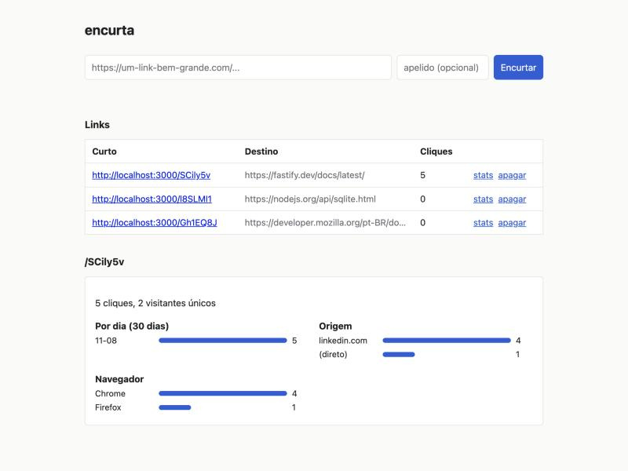

# encurta

Encurtador de links com estatísticas de clique. A parte que me interessava era o que acontece depois do redirect: de onde vieram os cliques, em que navegador, quantas pessoas diferentes.



## Como funciona

- `POST /api/links` cria o link (slug aleatório de 7 caracteres ou um apelido seu)
- `GET /:slug` redireciona com 302 e registra o clique
- `GET /api/links/:slug/stats` devolve total, visitantes únicos, cliques por dia (30 dias), origem e navegador
- Link pode ter data de expiração; depois dela responde 410
- Painel em `/` para criar e acompanhar links

A criação e as estatísticas exigem o header `x-api-key`. O redirect é público.

## Decisões

**302 e não 301.** Com 301 o navegador guarda o redirect em cache e o clique seguinte nem chega no servidor, então a contagem fica errada.

**Não guardo IP.** Cada clique salva um hash curto de `sal + IP + user-agent`. Dá para contar visitantes únicos sem manter dado pessoal no banco. A contrapartida é que o mesmo usuário em dois navegadores conta como duas pessoas.

**O que o encurtador recusa.** Só `http` e `https` (nada de `javascript:`), sem usuário e senha na URL, sem apontar para o próprio domínio. Slugs como `api` e `healthz` são reservados.

**Comparação da chave em tempo constante** (`timingSafeEqual` sobre o hash das duas strings), para não vazar o tamanho nem o conteúdo por tempo de resposta.

## Rodando

Node 24 ou mais novo.

```bash
npm install
API_KEY=$(openssl rand -hex 16) npm start
```

Anote a chave que você gerou, ela é pedida no painel. Para desenvolver com reload: `npm run dev` (também precisa de `API_KEY`).

| Variável | Padrão | |
|----------|--------|--|
| `API_KEY` | | obrigatória |
| `PORT` | 3000 | |
| `BASE_URL` | `http://localhost:PORT` | usada para montar o `shortUrl` |
| `DB_PATH` | `./data/encurta.db` | |
| `IP_SALT` | igual à `API_KEY` | sal do hash de visitante |

Exemplo com curl:

```bash
curl -X POST localhost:3000/api/links \
  -H "x-api-key: $API_KEY" -H "content-type: application/json" \
  -d '{"url": "https://exemplo.com/uma/url/enorme", "slug": "promo"}'
```

## Testes

```bash
npm test
npm run typecheck
```

Usam `app.inject()` do Fastify, então não abrem porta. Cobrem criação, slug repetido e reservado, URLs recusadas, expiração (forçada direto no banco) e as estatísticas.

## Limitações

- Não tem rate limit. Atrás de um proxy eu colocaria no próprio proxy ou usaria `@fastify/rate-limit`.
- `trustProxy` está ligado para o IP vir de `X-Forwarded-For`. Se for expor direto na internet sem proxy, desligue.
- A lista do painel mostra os 100 links mais recentes, sem paginação.
- Classificação de navegador é por regex no user-agent, bem simples.

## Licença

MIT
